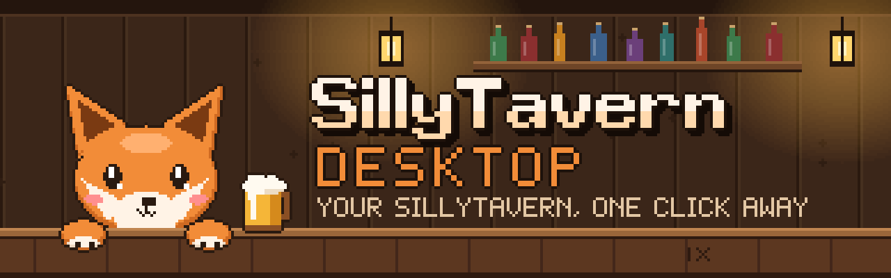
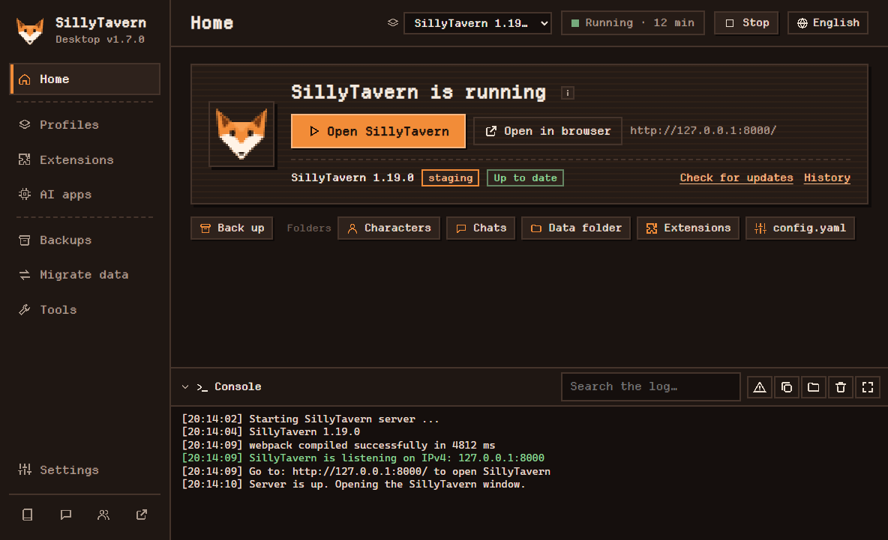
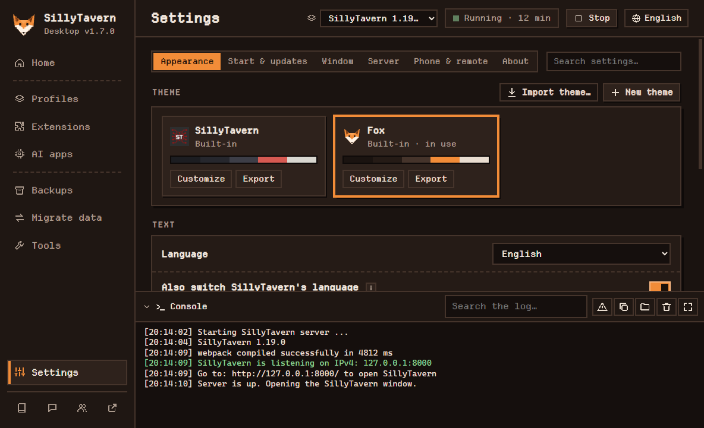
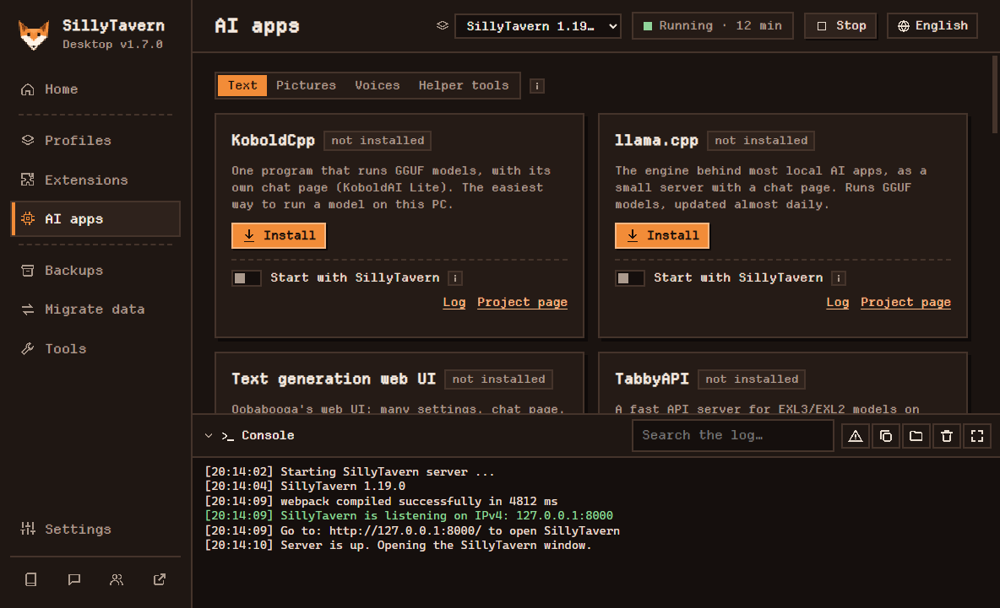

  

<!-- Closing time. The barkeep counts the bottles on the shelf, then looks at the fox. Same number, every night. -->

  
  
  
  

<h3 align="center">SillyTavern as a real Windows app.</h3>

  Double-click it and SillyTavern opens in its own window. 
  No command prompt to keep open, no browser tab to find, no scripts to run.

  <a href="https://github.com/Lab-Fox/sillytavern-desktop/releases/latest"><b>Download for Windows</b></a>
  &nbsp;·&nbsp; <a href="docs/USER-GUIDE.md">User guide</a>
  &nbsp;·&nbsp; <a href="docs/TROUBLESHOOTING.md">Troubleshooting</a>
  &nbsp;·&nbsp; <a href="docs/THEMES.md">Making themes</a>
  &nbsp;·&nbsp; <a href="docs/DEVELOPERS.md">For developers</a>

  

## What it is

[SillyTavern](https://github.com/SillyTavern/SillyTavern) is a free, open-source app for chatting and roleplaying with AI characters. **SillyTavern Desktop** runs *your own* SillyTavern for you: it installs it, starts it, updates it, backs it up and opens it in a window of its own, whether you've used SillyTavern for years or are just trying it out.

It doesn't modify SillyTavern: your SillyTavern stays the standard version, and its files are never changed. This app is a community project, not made by the SillyTavern team.

## Get started

1. **Download** from the [latest release](https://github.com/Lab-Fox/sillytavern-desktop/releases/latest). Pick one:
   - `SillyTavern-Desktop-Setup.exe`, the installer (recommended): you choose where it goes, Start menu and desktop shortcuts, opens in under a second. No admin rights needed.
   - `SillyTavern-Desktop.exe`, the portable version: nothing to install, just run it, even from a USB stick.
2. **Run it.** If you already have SillyTavern, the app finds it and uses it as it is. If not, the welcome screen installs it for you, along with Node.js and Git, which SillyTavern needs.

> Windows may show a SmartScreen warning because the app isn't code-signed. Click **More info → Run anyway**.

Needs **Windows 10 or 11**. Linux and macOS aren't supported yet ([help wanted](docs/DEVELOPERS.md#windows-only-for-now)).

## Why use it

| | Doing it by hand | With this app |
|---|---|---|
| **Setting up** | Install Node.js and Git, clone SillyTavern, run `npm install` | The welcome screen does it for you |
| **Starting** | Run `Start.bat`, keep its black window open, find the browser tab | Double-click the app |
| **Updating** | `git pull` and `npm install`, and hope nothing breaks | One button: back up, update, restart |
| **Backups** | Copy the `data` folder by hand | One click, automatic before updates, restore anytime |
| **Extensions** | Check each one yourself, and hope an update is safe | Safety ratings, a review before updating, one-click undo |
| **Problems** | Scroll through a terminal | A health check and one-click repairs |
| **On your phone** | Edit `config.yaml` and find your PC's address | One switch, then scan a QR code |

## Highlights

- **Its own window with tabs**: full screen, always on top, drag tabs into windows of their own.
- **Safe updates** for SillyTavern and its extensions, with backups first and undo after.
- **Profiles**: several SillyTavern installs or versions side by side, switched from the top bar. Download any version in one click.
- **Migrate data** between installs: characters, chats, presets, extensions, item by item, always undoable.
- **AI apps on your own PC**: KoboldCpp, llama.cpp, ComfyUI, Forge, AllTalk and more, installed in one click with models picked for your graphics card.
- **Use it from your phone**: scan a QR code to connect over your Wi-Fi, or reach it from outside with a Cloudflare link or Tailscale, protected by a password.
- **Drag and drop** character cards, lorebooks and presets to import them.
- **Themes you can make your own**: colors, shapes, fonts, wallpapers, GIFs and video placed where you want them, with no code in Theme Studio, or [with your own CSS](docs/THEMES.md).
- **Six languages**: English, Bahasa Indonesia, 日本語, 한국어, 简体中文, 繁體中文.

<table>
  <tr>
    <td></td>
    <td></td>
  </tr>
  <tr>
    <td align="center">Settings: six tabs and a search box</td>
    <td align="center">AI apps: install, start, connect</td>
  </tr>
</table>

The [user guide](docs/USER-GUIDE.md) covers everything else.

## Help and contributing

- Something not working? See [Troubleshooting](docs/TROUBLESHOOTING.md), then open an [issue](https://github.com/Lab-Fox/sillytavern-desktop/issues) with the system report from **Tools → Help**.
- Want to help? Read [For developers](docs/DEVELOPERS.md). Translations are welcome too: [add your language](locales/README.md), it's one file.
- Add-ons for the app: [how to make one](EXTENSIONS.md), and the [add-on list](https://github.com/Lab-Fox/sillytavern-desktop-extensions).

<b>Credits</b>

- [SillyTavern](https://github.com/SillyTavern/SillyTavern), the software this app runs. Go give it a star.
- SillyTavern's own `src/electron` launcher showed that this approach works.
- [qrcode-generator](https://github.com/kazuhikoarase/qrcode-generator) (MIT) draws the phone QR code.
- [electron-chrome-extensions and electron-chrome-web-store](https://github.com/samuelmaddock/electron-browser-shell) by Samuel Maddock (MIT) make Chrome extensions and the Chrome Web Store work.
- Extension safety ratings: TavernKeeper scans from [Tavernary](https://tavernary.org) (ODbL).
- Writing helper word lists (downloaded by the add-on, not included): [SCOWL / en-wl wordlist](https://github.com/en-wl/wordlist) by Kevin Atkinson and contributors (MIT-like) and [FrequencyWords](https://github.com/hermitdave/FrequencyWords) by Hermit Dave (CC BY-SA 4.0, from OpenSubtitles).
- The banner, its lettering included, is drawn by a few small scripts in [`tools/art`](tools/art), with two pixel fonts made for this project: *Tavern* and *Tally*.
- Fonts: [Departure Mono](https://departuremono.com/) by Helena Zhang, [DotGothic16](https://fonts.google.com/specimen/DotGothic16), [Pixelify Sans](https://fonts.google.com/specimen/Pixelify+Sans) and [VT323](https://fonts.google.com/specimen/VT323) (all SIL Open Font License; the licences are in `fonts/`).

## License

[AGPL-3.0](LICENSE), the same as SillyTavern.
